Міністерство освіти і науки України  
Національний технічний університет України  
«Київський політехнічний інститут імені Ігоря Сікорського»  

Факультет інформатики та обчислювальної техніки  

Кафедра обчислювальної техніки  

**Лабораторна робота №1**  
з дисципліни «Системне програмування»  
«Налаштування середовища розробки та bring-up STM32-платформи»  

Виконав:  
студент 4 курсу  
групи ІО-32  
Шведенко Іван Олексійович  

Перевірив:  
Гордієнко Н.Ю.  

Київ — 2026  

---

### Лабораторна робота №1

### Налаштування середовища розробки та bring-up STM32-платформи

# 1. Мета лабораторної

Розібратися з повним циклом розробки під STM32: налаштувати збірку в Docker, запустити прошивку в симуляторі Wokwi і отримати вивід у UART. Перевірити роботу I²C, ADC, PWM і GPIO, а також описати вимоги до свого проєкту у вигляді PRD.

Репозиторій: https://github.com/ivan32232323/STM32-Lab1

# 2. Розподіл обов'язків

Робота виконана одноосібно, таблиця не потрібна.

# 3. Процес виконання

## 3.1. Журнал роботи

| Дата | Що зроблено |
|---|---|
| 06.11 | Встановлено VS Code, плагін Wokwi, Git, Docker Desktop. Створено Dockerfile і кореневий Makefile |
| 06.11 | Створено проєкт під Nucleo-C031C6: HAL, CMSIS, startup, linker, .ioc |
| 06.11 | printf через USART2, ініціалізація I2C1, ADC1, TIM3, GPIO, I²C-скан, WHO_AM_I, вивід tick N |
| 06.11 | Складено diagram.json, docs/hardware-components.md і docs/PRD.md |
| 06.11 | Запуск у Wokwi, налагодження читання MPU-6050, захоплення I²C логічним аналізатором |
| 06.11 | Скриншоти і звіт |

## 3.2. Docker-тулчейн

Образ stm32-build на базі ubuntu:22.04 з arm-none-eabi-gcc. Збірка запускається командою make build і не залежить від налаштувань системи. На Windows без make можна запустити build.bat.

```
make image   # docker build -t stm32-build docker/
make build   # docker run ... stm32-build make -C firmware all
```

```
LD  build/firmware.elf
   text    data     bss     dec     hex filename
  25612     112    2320   28044    6d8c build/firmware.elf
```

Коміт: https://github.com/ivan32232323/STM32-Lab1/commit/decebf5

## 3.3. STM32CubeMX

| Периферія | Параметри | Виводи |
|---|---|---|
| USART2 | 115200 8N1 | PA2 / PA3 |
| I2C1 | Standard Mode, 100 kHz | PB8 (SCL) / PB9 (SDA) |
| TIM3 CH1, CH2 | PWM 50 Hz (Prescaler = 47, Period = 19999) | PA6 / PA7 |
| ADC1 | IN0 | PA0 |
| GPIO | кнопка MODE (pull-up), світлодіод LD4 | PA10 / PA5 |

SYSCLK = 48 MHz. Проєкт з тулчейном Makefile, файл .ioc збережено в репозиторії.

Pinout:

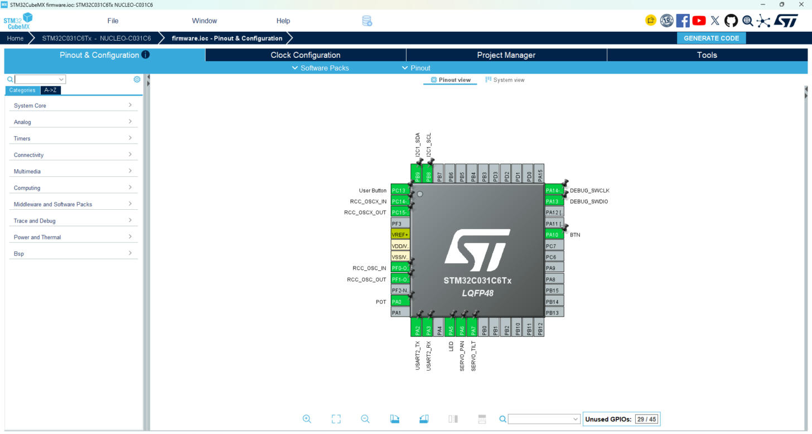

Clock Configuration:

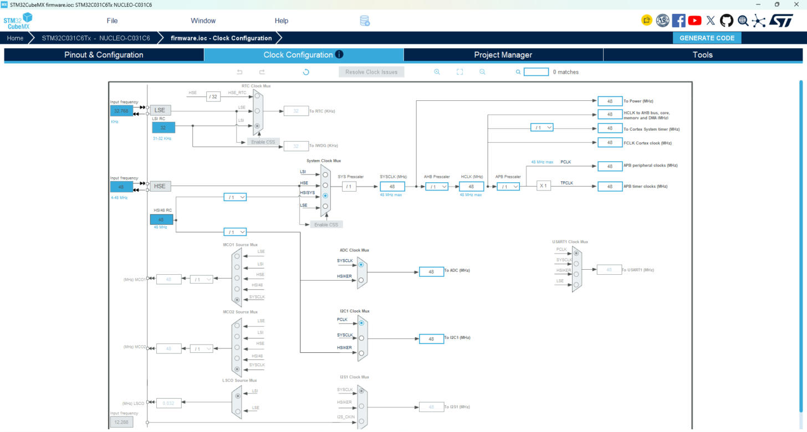

Коміт: https://github.com/ivan32232323/STM32-Lab1/commit/de33102

## 3.4. Перший запуск у Wokwi

printf перенаправлено в USART2 через функцію _write(). Налаштовано wokwi.toml і diagram.json. Розмір прошивки — 25 612 байт.

Вивід у терміналі Wokwi після першого запуску:

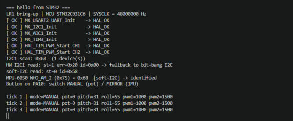

Коміт: https://github.com/ivan32232323/STM32-Lab1/commit/de33102

## 3.5. Компоненти і datasheets

У docs/hardware-components.md для кожного компонента вказано інтерфейс, адресу, ключові регістри і параметри з номером сторінки datasheet.

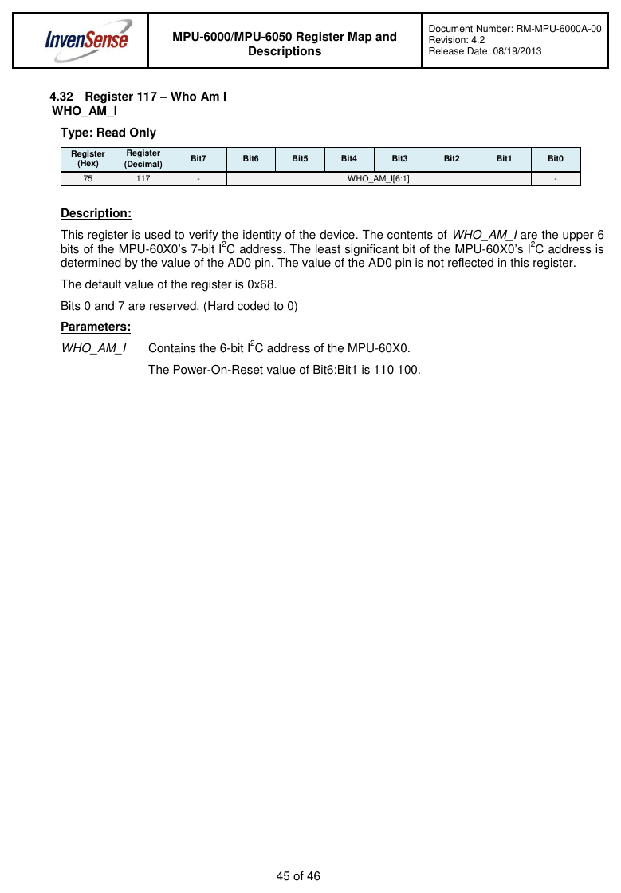

Джерело: [1], с. 45 — регістр WHO_AM_I

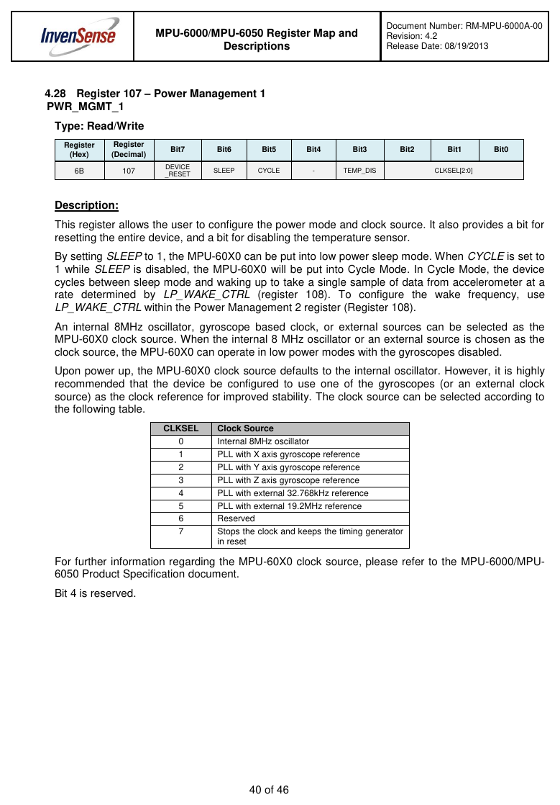

Джерело: [1], с. 40 — PWR_MGMT_1

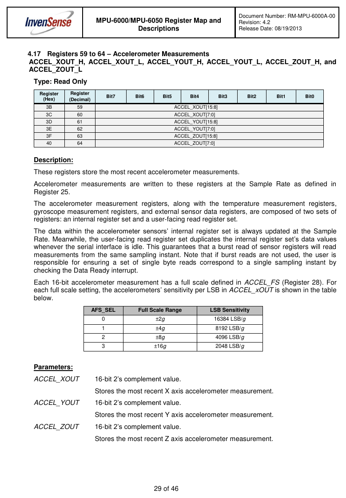

Джерело: [1], с. 29 — регістри акселерометра

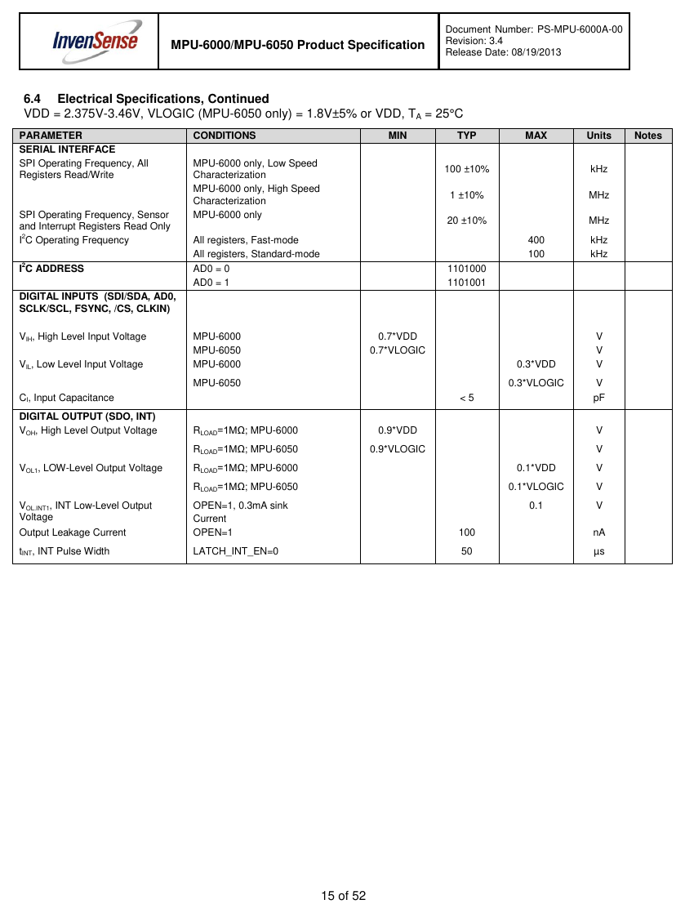

Джерело: [2], с. 15 — I²C-адреса і частота

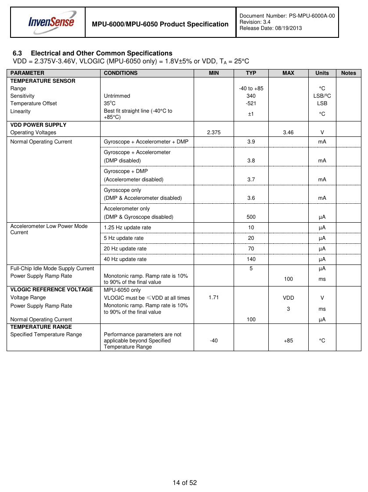

Джерело: [2], с. 14 — струм споживання

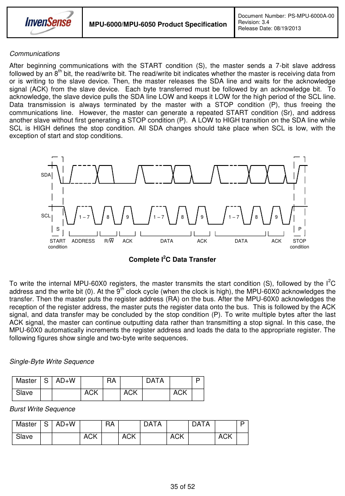

Джерело: [2], с. 35 — протокол I²C

Коміт: https://github.com/ivan32232323/STM32-Lab1/commit/de33102

## 3.6. Сенсори і перевірка шин

До diagram.json додано MPU-6050, потенціометр, два серво SG90, кнопку і логічний аналізатор. Кнопкою перемикається режим: MANUAL (серво від потенціометра) або MIRROR (серво повторюють нахил MPU-6050).

Робота в режимі MIRROR:

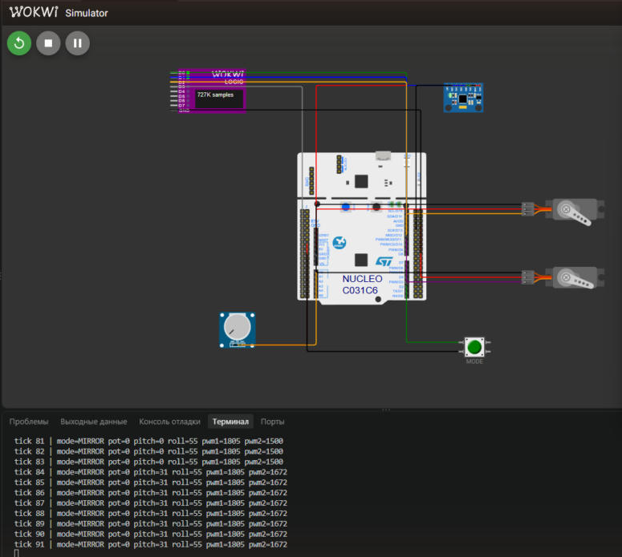

Декодована транзакція WHO_AM_I (запис з логічного аналізатора Wokwi, wokwi.vcd):

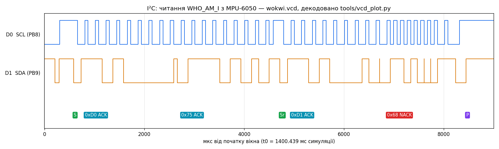

PWM на виводі серво:

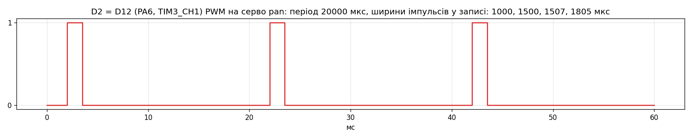

Коміт: https://github.com/ivan32232323/STM32-Lab1/commit/de33102

## 3.7. Проблеми та їх вирішення

Проблема 1: у Wokwi немає Nucleo-F411RE / F446RE  
Симптом: у списку плат Wokwi є тільки Nucleo-C031C6 і Nucleo-L031K6.  
Причина: Wokwi симулює лише кілька плат STM32, лінійки F4 серед них немає.  
Фікс: взяв Nucleo-C031C6, підключив HAL для STM32C0 і змінив у Makefile -mcpu на cortex-m0plus.  
Коміт: https://github.com/ivan32232323/STM32-Lab1/commit/de33102

Проблема 2: збірка падає на m-profile/cmsis_gcc_m.h: No such file or directory  
Симптом: make build -> fatal error у cmsis_gcc.h.  
Причина: змішав версії CMSIS: cmsis_gcc.h був з CMSIS 6 і підключає m-profile/, а пакет HAL для C0 іде з CMSIS 5, де цієї папки немає.  
Фікс: взяв папку CMSIS/Include з того ж пакета, що й HAL.  
Коміт: https://github.com/ivan32232323/STM32-Lab1/commit/de33102

Проблема 3: implicit declaration of function HAL_TIM_MspPostInit  
Симптом: попередження при збірці в MX_TIM3_Init().  
Причина: функція визначена в stm32c0xx_hal_msp.c, а її прототип CubeMX кладе в main.h. У моєму main.h його не було.  
Фікс: додав прототип функції в main.h.  
Коміт: https://github.com/ivan32232323/STM32-Lab1/commit/de33102

Проблема 4: make build не працює на Windows  
Симптом: у PowerShell немає make, а $(id -u) у Makefile не спрацьовує.  
Причина: команда id є тільки в Unix-оболонці. На Windows Docker Desktop і так створює файли від імені користувача, тому --user там не потрібен.  
Фікс: для Windows прибрав --user у Makefile і додав build.bat.  
Коміт: https://github.com/ivan32232323/STM32-Lab1/commit/decebf5

Проблема 5: MPU-6050 — WHO_AM_I = 0x00  
Симптом: I²C-скан бачить 0x68, але HAL_I2C_Mem_Read повертає HAL_ERROR (err = 0x20, timeout). Master_Transmit + Master_Receive дають те саме.  
Причина: у логічному аналізаторі видно, що після адреси читання 0xD1 немає тактів SCL. Модель I²C STM32C0 у Wokwi не тактує шину в режимі прийому, а запис (і тому скан) працює.  
Фікс: зробив читання програмним I²C на тих самих пінах, SDA під час читання перемикаю на вхід. Після цього WHO_AM_I = 0x68.  
Коміт: https://github.com/ivan32232323/STM32-Lab1/commit/de33102

# 4. Висновок

Навчився:

- збирати прошивку STM32 в Docker однією командою make build;
- налаштовувати тактування через HAL: HSI48 без дільника дає SYSCLK = 48 МГц;
- рахувати Prescaler і Period таймера для PWM 50 Гц під серво (48 МГц / 48 = 1 МГц, період 20000 тактів);
- виводити printf в UART через _write() і перевіряти статус кожної ініціалізації HAL;
- знаходити в datasheet адресу, регістри і живлення датчика;
- перевіряти I²C-пристрої за адресою і WHO_AM_I та розбирати транзакцію в логічному аналізаторі.

Що зробив би інакше: одразу перевірив би, які плати є у Wokwi, і створив проєкт у CubeMX під Nucleo-C031C6; брав би HAL і CMSIS з одного пакета; раніше підключив би логічний аналізатор — проблему з I²C знайшов би швидше; комітив би частіше, після кожного кроку.

Куди рухаюся в ЛР2: почати реалізацію вимог з PRD — читати гіроскоп, додати фільтр для кутів, виміряти затримку від руху датчика до руху серво.

# 5. Матеріали та посилання

1. InvenSense. MPU-6000/MPU-6050 Register Map and Descriptions, RM-MPU-6000A-00, rev 4.2. 46 с.
2. InvenSense. MPU-6000/MPU-6050 Product Specification, PS-MPU-6000A-00, rev 3.4, 19.08.2013. 52 с.
3. STMicroelectronics. STM32C031x4/x6 Datasheet, DS13867. https://www.st.com/en/microcontrollers-microprocessors/stm32c031c6.html
4. STMicroelectronics. RM0490 Reference Manual: STM32C0 series. https://www.st.com/en/microcontrollers-microprocessors/stm32c031c6.html#documentation
5. STMicroelectronics. STM32 Nucleo-64 boards (MB1717), user manual UM2953. https://www.st.com/resource/en/user_manual/um2953-stm32-nucleo64-board-mb1717-stmicroelectronics.pdf
6. TowerPro. SG90 Micro Servo datasheet.
7. Wokwi. Документація: diagram.json, STM32 Nucleo-C031C6. https://docs.wokwi.com

# 6. Відеозвіт

Відео (2–3 хв): представлення, запуск прошивки у Wokwi і лог UART: [посилання на відео буде додано]

# 7. PRD (Product Requirements Document)

Окремий файл docs/PRD.md: https://github.com/ivan32232323/STM32-Lab1/blob/lab1/docs/PRD.md

Тема — проєкт 6 «Motion-Mirroring Teleoperator»: два серво повторюють нахил руки, виміряний MPU-6050. У PRD: A — загальна ідея, B — 11 функціональних вимог FR-01…FR-11, C — датчики з інтерфейсами, обґрунтуванням і альтернативами, D — план тестування для кожної вимоги.

Коміт: https://github.com/ivan32232323/STM32-Lab1/commit/de33102
